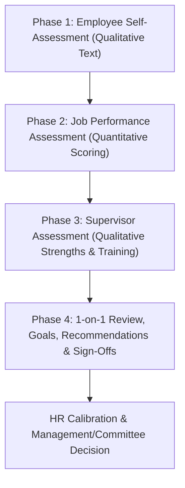
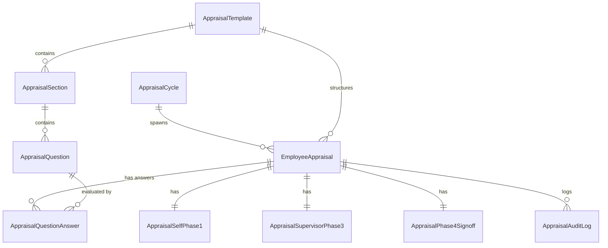
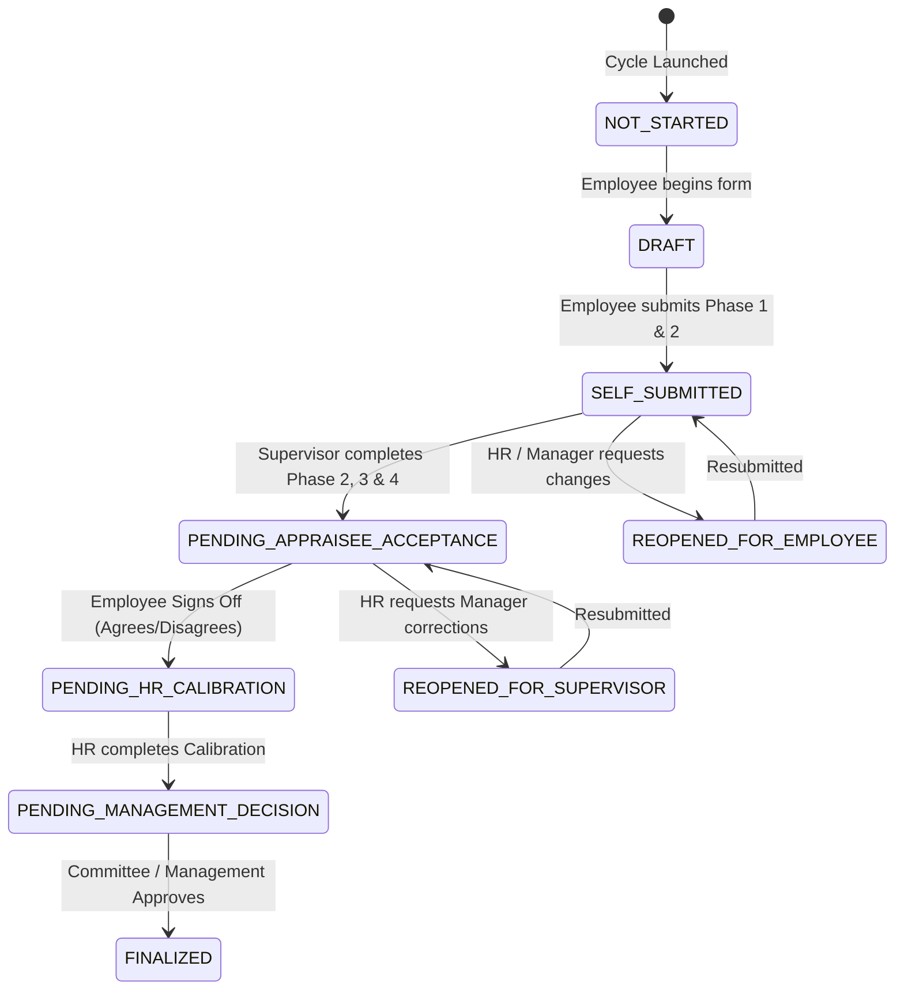

# HRMS Staff Appraisal Module Architecture & Implementation Plan

## 1. Overview & Core Objectives

The Staff Appraisal Module provides a dynamic, structured, multi-stage performance evaluation system within the Incel Group HRM backend. 

Based on the **HRM Application PRD** and the **End of Year Appraisal Template (`hrms end of year appraisal sample.xlsx`)**, the module supports:
1. **Department-Specific Templates & Flexible Questionnaires**: Questions and performance sections vary by department (e.g., Sales vs. Engineering vs. HR), but the overall **4-Phase Evaluation Structure** remains universal across the entire organization.
2. **Hybrid & Weighted Scoring Model**: Section-level weightings (e.g., Sales Strategy 15%, Target Achievement 20%), Likert-scale ratings (1–5 or 1–4), with pre-calculated weighted totals and performance tier classification.
3. **Multi-Stage Workflow & State Machine**: Granular control across Employee Self-Assessment, Line Manager Evaluation, 1-on-1 Discussion & Employee Acceptance, HR Calibration, and Executive Management/Appraisal Committee Sign-off.
4. **Auditability & Policy Controls**: Complete tracking of edits (especially post-deadline HR adjustments) and audit history.

---

## 2. Universal 4-Phase Appraisal Structure

Every appraisal follows 4 sequential phases regardless of department:

| Phase | Description | Key Inputs | Primary Actor |
| :--- | :--- | :--- | :--- |
| **Phase 1** | Employee Self-Assessment | Key achievements, noteworthy wins, challenges encountered, support needed from management | Appraisee (Employee) |
| **Phase 2** | Job Performance Assessment | Section-by-section rating of department KPIs/competencies. Dual rating: Employee Self-Rating vs Supervisor Rating. Automated weighted score computation | Appraisee & Supervisor |
| **Phase 3** | Supervisor Qualitative Evaluation | Identification of key strengths, specific areas for development, required training & certifications | Supervisor / Line Manager |
| **Phase 4** | 1-on-1 Goal Setting, Outcome & Sign-Off | Next year goals, Supervisor performance rating classification (90-100 Exceptional, 80-89 High, etc.), Recommendations (Commendation, Bonus, Promotion, PIP, etc.), Manager Comments, Appraisee Acceptance (Agree/Disagree + comments), HR Review & Committee Decision | Supervisor, Appraisee, HR, Management |

---

## 3. Database Schema Design (Django ORM)

The module will be encapsulated under `apps/appraisal/` with clean relational models:

### Key Models & Specification

#### A. Template & Cycle Management
- **`AppraisalCycle`**: Represents an active evaluation period (e.g., "2026 End of Year Appraisal", "Q3 90-Day Check").
  - `name`: CharField
  - `cycle_type`: CharField (`90_DAY`, `6_MONTH`, `BI_ANNUAL_JULY`, `BI_ANNUAL_DECEMBER`)
  - `start_date`, `end_date`, `submission_deadline`: DateFields
  - `status`: CharField (`DRAFT`, `ACTIVE`, `CLOSED`, `ARCHIVED`)
  - `weight_config`: JSONField (optional global weight overrides)

- **`AppraisalTemplate`**: Department / Role specific form blueprint.
  - `title`: CharField (e.g., "Sales Department Annual Appraisal Template")
  - `department`: ForeignKey (`apps.accounts.Department`, nullable for general template)
  - `is_active`: BooleanField

- **`AppraisalSection`**: Sections inside a template (e.g., "Sales Strategy & Business Development").
  - `template`: ForeignKey (`AppraisalTemplate`)
  - `title`: CharField
  - `section_code`: CharField (`SECTION_A`, `SECTION_B`, etc.)
  - `weight`: DecimalField (e.g., `15.00` for 15%)
  - `rating_scale_max`: IntegerField (Default: `5`, supports `4` or `5` Likert scale)
  - `order`: PositiveIntegerField

- **`AppraisalQuestion`**: KPIs/Competency items in a section.
  - `section`: ForeignKey (`AppraisalSection`)
  - `prompt`: Textarea / CharField
  - `description`: Text (guidelines for rating 1 to 5)
  - `order`: PositiveIntegerField

#### B. Employee Evaluation Instance & Responses
- **`EmployeeAppraisal`**: Central record linking employee, cycle, template, and supervisor.
  - `employee`: ForeignKey (`User`, related_name="appraisals")
  - `supervisor`: ForeignKey (`User`, related_name="subordinate_appraisals")
  - `cycle`: ForeignKey (`AppraisalCycle`)
  - `template`: ForeignKey (`AppraisalTemplate`)
  - `status`: CharField (State machine enum)
  - `self_score_total`: DecimalField (Pre-calculated Self Grand Total Score %)
  - `supervisor_score_total`: DecimalField (Pre-calculated Supervisor Grand Total Score %)
  - `performance_category`: CharField (`EXCEPTIONAL`, `HIGH`, `GOOD`, `DEVELOPING`, `UNDER`)
  - Timestamps for each workflow transition (`self_submitted_at`, `supervisor_submitted_at`, `appraisee_signed_at`, `hr_reviewed_at`, `finalized_at`)

- **`AppraisalSelfPhase1`**: Qualitative self-assessment.
  - `appraisal`: OneToOneField (`EmployeeAppraisal`)
  - `key_achievements`: Text (Based on previous goals)
  - `noteworthy_achievements`: Text
  - `challenges_encountered`: Text
  - `support_needed`: Text

- **`AppraisalQuestionAnswer`**: Question-level ratings and comments.
  - `appraisal`: ForeignKey (`EmployeeAppraisal`)
  - `question`: ForeignKey (`AppraisalQuestion`)
  - `self_rating`: IntegerField (1–5, nullable until self-assessment submitted)
  - `supervisor_rating`: IntegerField (1–5, nullable until supervisor submitted)
  - `comments`: Text (optional per-question rationale)

- **`AppraisalSupervisorPhase3`**: Qualitative supervisor assessment.
  - `appraisal`: OneToOneField (`EmployeeAppraisal`)
  - `strengths`: Text
  - `areas_for_development`: Text
  - `training_development_needs`: Text

- **`AppraisalPhase4Signoff`**: 1-on-1, outcome recommendations, and approvals.
  - `appraisal`: OneToOneField (`EmployeeAppraisal`)
  - `goals_next_year`: Text
  - `recommendations`: JSONField (Array of choices e.g., `["COMMENDATION", "BONUS", "PROMOTION"]`)
  - `recommendation_others`: Text
  - `supervisor_comments`: Text
  - `appraisee_agrees`: BooleanField (null until appraisee responds)
  - `appraisee_disagree_reason`: Text (mandatory if `appraisee_agrees` is False)
  - `appraisee_additional_comments`: Text
  - `hr_observations`: Text
  - `hr_recommended_action`: Text
  - `management_comments`: Text
  - `committee_decision`: Text

---

## 4. Automated Scoring Algorithm

Each section $k$ has a target weight $W_k$ (e.g. 15%) and $N_k$ questions, each evaluated on a Likert scale with maximum value $M_k$ (usually 5).

### Section Weighted Score Calculation:
For ratings given by evaluator (Self or Supervisor) $r_{k,i}$ for question $i$ in section $k$:

$$\text{Raw Score}_k = \sum_{i=1}^{N_k} r_{k,i}$$

$$\text{Max Raw Score}_k = N_k \times M_k$$

$$\text{Section Score}_k (\%) = \left( \frac{\text{Raw Score}_k}{\text{Max Raw Score}_k} \right) \times W_k$$

### Grand Total Score Calculation:
$$\text{Grand Total Score} (\%) = \sum_{k} \text{Section Score}_k$$

### Performance Tier Mapping Table (Supervisor Score):

| Supervisor Score Range (%) | Performance Classification | Result Code |
| :--- | :--- | :--- |
| **90.00% – 100.00%** | Exceptional Performer | `EXCEPTIONAL` |
| **80.00% – 89.99%** | High Performer | `HIGH` |
| **65.00% – 79.99%** | Good Performer | `GOOD` |
| **50.00% – 64.99%** | Developing Performer | `DEVELOPING` |
| **Below 50.00%** | Under Performer | `UNDER` |

---

## 5. Workflow State Machine & Transition Rules

### Action Roles & Permissions:
1. **Employee (Appraisee)**: Fills Phase 1 & Phase 2 self ratings when in `DRAFT`. Performs final sign-off (Agree/Disagree) in `PENDING_APPRAISEE_ACCEPTANCE`.
2. **Supervisor / Line Manager**: Fills Phase 2 supervisor ratings, Phase 3 qualitative, Phase 4 goals & recommendations when status is `SELF_SUBMITTED`.
3. **HR Administrator**: Manages cycles & templates, monitors completion rate, re-opens submissions when necessary, conducts calibration in `PENDING_HR_CALIBRATION`.
4. **Appraisal Committee / Management**: Reviews final scores & recommendations, enters management comments and committee decision to transition to `FINALIZED`.

---

## 6. REST API Endpoint Blueprint

Prefix: `/api/v1/appraisals/`

### Template & Cycle Management (HR / Admin)
- `GET /api/v1/appraisals/cycles/` - List/Filter appraisal cycles.
- `POST /api/v1/appraisals/cycles/` - Create a new appraisal cycle & auto-assign templates to employees.
- `GET /api/v1/appraisals/templates/` - List templates by department.
- `POST /api/v1/appraisals/templates/` - Create/Update dynamic department templates & questions.

### Employee & Manager Workflows
- `GET /api/v1/appraisals/my-appraisals/` - List current & past appraisals for logged-in employee.
- `GET /api/v1/appraisals/team-appraisals/` - List appraisals of direct reports (Supervisor view).
- `GET /api/v1/appraisals/:id/` - Retrieve complete appraisal details (all 4 phases + computed scores).
- `PATCH /api/v1/appraisals/:id/self-assessment/` - Submit/Save draft for Phase 1 & Phase 2 self-ratings.
- `POST /api/v1/appraisals/:id/submit-self/` - Transition from `DRAFT` to `SELF_SUBMITTED`.
- `PATCH /api/v1/appraisals/:id/supervisor-assessment/` - Submit Phase 2 supervisor ratings, Phase 3, & Phase 4 goals.
- `POST /api/v1/appraisals/:id/submit-supervisor/` - Transition to `PENDING_APPRAISEE_ACCEPTANCE`.
- `POST /api/v1/appraisals/:id/appraisee-signoff/` - Employee Agree/Disagree signoff.
- `POST /api/v1/appraisals/:id/hr-calibrate/` - HR calibration & observations.
- `POST /api/v1/appraisals/:id/finalize/` - Management / Committee final decision.
- `POST /api/v1/appraisals/:id/reopen/` - HR override to reopen stage.

---

## 7. Next Steps & Recommended Implementation Phases

1. **Phase 1 Backend Foundation**:
   - Create `apps/appraisal` Django app.
   - Implement models (`AppraisalCycle`, `AppraisalTemplate`, `AppraisalSection`, `AppraisalQuestion`, `EmployeeAppraisal`, `AppraisalQuestionAnswer`, etc.).
   - Create migrations and seed initial template for Sales (based on sample Excel).
2. **Phase 2 Scoring & Workflow Engine**:
   - Implement score calculation logic in Django service layer.
   - Add state machine transition validation & permissions.
3. **Phase 3 API Endpoints & DRF Views**:
   - Implement ViewSets & Serializers for all 4 phases and sign-offs.
   - Add notifications on status transitions (Celery tasks).
4. **Phase 4 Automated Unit & Integration Tests**:
   - Test scoring precision, workflow state transitions, permission security checks, and HR reopening overrides.
